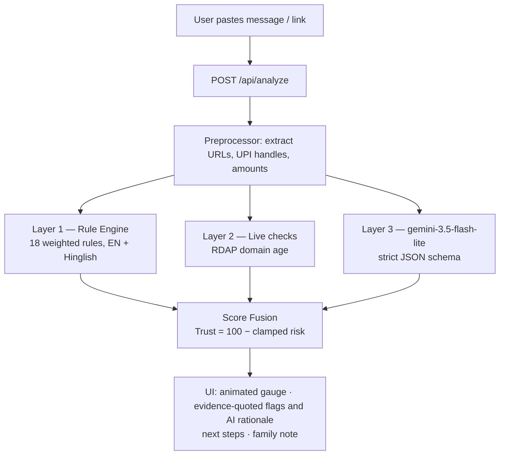

<div align="center">

# 🛡️ ScamShield AI

### Real-time fraud forensics for Indian messaging — deterministic rule engine, live domain intelligence, explainable AI scoring.

Every scam message has a pattern.

> 🎙️ **v2 (built during HACKDAY 1.0):** Voice-note analysis — upload audio file (WAV is the only verified format; MP3 and OGG/OPUS expected to work, pending live verification; FLAC and AIFF untested; AAC removed pending live verification), get a transcript + Trust Score.

**Paste any suspicious message → Get a Trust Score with evidence-quoted red flags (or AI rationale), scam classification, and a family-friendly Hinglish explainer**

[Live Demo](<PASTE_VERCEL_URL>) · [GitHub Repo](https://github.com/Himanshu-GenAI/Phish_Gaurd) · [Issues](https://github.com/Himanshu-GenAI/Phish_Gaurd/issues) · [How It Works](#-how-the-trust-score-works--the-innovation) · [Evaluation](#-benchmark-evaluation--empirical-results) · [Try the Samples](#-judges-90-second-demo)

[](https://github.com/Himanshu-GenAI/Phish_Gaurd/actions/workflows/ci.yml)


Built for HACKDAY 1.0 by DECODEP — v2 voice-note analysis built during the live 8-hour window.

</div>

---

## 🌍 Tech for a Better Tomorrow

The tomorrow we're building is one where a parent hangs up on a "digital arrest" call without fear. Where the evidence of a scam is understood the moment its message arrives — not after the money is gone. Where a ₹499 "registration fee" is recognized as the trap it is. ScamShield exists to make that tomorrow ordinary.

---

## 📖 Contents

[Tech for a Better Tomorrow](#-tech-for-a-better-tomorrow) · [The Problem](#-the-problem) · [Why Existing Tools Fail](#-why-existing-tools-fail) ·
[Our Solution](#-our-solution) · [How the Trust Score Works](#-how-the-trust-score-works--the-innovation) ·
[Scam Taxonomy](#-scam-taxonomy-we-detect) · [Architecture](#️-architecture) ·
[Tech Stack](#️-tech-stack---why) · [Getting Started](#-getting-started) ·
[Benchmark Evaluation](#-benchmark-evaluation--empirical-results) · [Judge's 90-Second Demo](#-judges-90-second-demo) ·
[Roadmap](#️-roadmap) · [Limitations](#-limitations) ·
[Evaluation Criteria](#-hackday-10--evaluation-criteria-mapping-weighted) · [Sources](#-research-sources)

---

## 🚨 The Problem

> ⚠️ *Statistics (2024 data) as reported in media citing I4C / Government of India data — live sources linked below.*

India is in the middle of its largest cyber-fraud wave:

- 💸 **₹22,000+ crore (~US$2.7B)** lost to cyber fraud in Jan–Nov 2024; complaints on the National Cybercrime Reporting Portal crossed **1 crore** (I4C data, via Reuters).
- 👮 **"Digital arrest" scams** — impersonators posing as CBI/customs/police extorted **₹120+ crore in Q1 2024 alone**; the Prime Minister had to address it on Mann Ki Baat: *"No agency ever conducts a digital arrest."*
- 🎓 **Students are prime targets** — fake internships demanding "registration fees", Telegram-only "HR", and too-good-to-be-true work-from-home pay.
- 🎙️ **AI voice cloning** — seconds of audio are enough; India is among the worst-hit countries (McAfee global survey).

**The cruel part:** every one of these scams arrives as a *message*. The victim is holding the evidence and can't read it — by the time they search "is this a scam?", they've often already paid.

**ScamShield puts a fraud analyst in everyone's pocket — one paste away.**

---

## 🔍 Why Existing Tools Fail

| Tool | Checks | Misses |
|---|---|---|
| Google Safe Browsing / VirusTotal | URL blocklists | Message-level context, zero-day pages, non-URL scams |
| Truecaller | Phone numbers | Text scams, job fraud, digital arrest |
| Bank / UPI warnings | Transactions (too late) | The scam starts hours before the payment |
| Asking a chatbot | Generic, inconsistent | No scoring, no live checks, no explainability, no Hinglish |

**The gap:** no tool does *message-level, India-specific, Hinglish-aware, explainable* scam analysis with **live deterministic verification**. ScamShield is built for the scams hitting Indian inboxes *right now*.

---

## 💡 Our Solution

1. **🧭 Trust Score (0–100)** — one glance tells you if it's safe
2. **🚩 Explainable red flags** — every deduction shown with exact quotes from your message for rules, or AI rationale for semantic cues
3. **🧬 Scam-type classification** — digital arrest, fake internship, task scam, investment group, and more
4. **✅ "What to do next"** — concrete steps, incl. reporting via **1930** / cybercrime.gov.in / Chakshu
5. **👨‍👩‍👧 Family mode** — a forwardable, jargon-free Hinglish explainer for parents
6. **🎙️ v2 (built during HACKDAY 1.0): Voice-note analysis** — upload audio file (WAV verified; MP3 and OGG/OPUS expected to work, pending live verification; FLAC/AIFF untested), get transcript + Trust Score


> 🔒 **Privacy-first:** messages are analyzed in memory and **not persisted by the app** (no database, no disk logging). To generate semantic forensics and transcription, text and audio payloads are transmitted to Google's Gemini API for processing. No login. No tracking.

---

## 🧠 How the Trust Score Works — *The Innovation*

Most "AI detectors" are just a prompt. ScamShield uses a **hybrid three-layer engine**:

```
Risk = clamp( Σ rule weights + Σ live-check weights + Σ AI weights , 3–100 )
Trust = 100 − Risk
```

| Layer | What it checks | Why |
|---|---|---|
| **1. Rule Engine (18 rules)** | Fees, UPI handles, authority impersonation, urgency, Hinglish keywords | Deterministic, explainable, instant — the backbone |
| **2. Live Checks (RDAP)** | Domain registration age | Identifies newly registered domains the rules cannot observe |
| **3. Gemini (structured JSON)** | Tone, coercion, vagueness, channel mismatch | Evaluates semantic coercion, tone, and context with a strict schema |
| **🎙️ v2: Voice-note analysis** | Upload audio file (WAV verified; MP3 and OGG/OPUS expected to work, pending live verification; FLAC/AIFF untested) | In-memory multimodal speech-to-text forensics via Gemini `inline_data` |

**Why a hybrid design:** deterministic rules provide instant, reproducible baseline explainability; foundation models add semantic understanding for evasive text; and live infrastructure checks detect newly registered domains — fusing deductions with traceable evidence rather than relying solely on a single mechanism.

### Sample rules (of 18)

| Signal | Weight | Evidence example |
|---|---|---|
| Upfront fee / "registration fee" | +25 | *"pay ₹499 registration fee"* |
| OTP/PIN/CVV request · remote-control app | +25 | *"share the OTP"*, *"install AnyDesk"* |
| Personal UPI handle | +20 | *"pay to quickjobs@ybl"* |
| Authority impersonation / digital arrest | +20 | *"FIR filed against your Aadhaar"* |
| Urgency · "only 2 slots left" | +15 | *"closes today"* |
| HR only on Telegram/WhatsApp | +15 | *"contact HR only on Telegram"* |
| **No-fee statement · formal interview · corporate email** | **−8/−6/−5** | *legitimacy signals reduce risk* |

### Verdict bands

| Trust Score | Verdict |
|---|---|
| 🟢 75–100 | Likely genuine — standard caution |
| 🟡 50–74 | Suspicious — verify independently |
| 🟠 25–49 | High risk — likely scam, don't pay |
| 🔴 0–24 | Almost certainly a scam — report it |

---

## 🎯 Scam Taxonomy We Detect

Researched from NCRP complaint patterns, government advisories, and media reporting:

| # | Type | Signature we encode |
|---|---|---|
| 1 | Digital Arrest | Authority + video call + urgency + secrecy + payment |
| 2 | Fake Job/Internship | Fee + salary/skill mismatch + Telegram-only HR + no interview |
| 3 | Task/Prepayment | Small real payouts first, then "premium tasks" need deposits |
| 4 | Investment/Trading Group | Guaranteed returns + personal UPI + withdrawal "tax/fee" |
| 5 | KYC/Utility/Courier | Link + authority + deadline ("electricity cut tonight") |
| 6 | UPI Collect Fraud | PIN entered to *receive* money — PIN only ever *pays* |
| 7 | Loan-App Extortion | APK + contact harvesting |
| 8 | AI Voice-Clone Emergency | Urgency + unusual payment request from "family" |
| 9 | Fake Customer Care | Unverified number + remote-app install request |
| 10 | Phishing/APK Delivery | Fake KYC pages, malicious APKs via WhatsApp |

---

## 🏗️ Architecture



> Privacy by design: stateless pipeline — message text and voice notes are analyzed in memory and discarded without persistence in app databases or local storage. Text and audio payloads are transmitted to Google's Gemini API for processing via REST and multimodal `inline_data`.

---

## 🛠️ Tech Stack — & Why

| Layer | Choice | Why |
|---|---|---|
| Framework | Next.js (App Router) + TypeScript strict | One deploy for UI + API; type-safe contracts |
| Styling | Tailwind CSS | Fast, consistent, dark-theme-first |
| AI | gemini-3.5-flash-lite via REST | Free tier, fast, native structured-JSON (responseSchema) — no SDK lock-in |
| Live checks | RDAP (rdap.org) | Free, keyless, authoritative registration data |
| Rules | Pure TypeScript + regex lexicons | Deterministic, unit-testable, zero cost |
| Hosting | Vercel | Live demo link, zero-config |

> 📌 **Note:** As of 2026-10-18 no shutdown date was listed for gemini-3.5-flash-lite on Google's deprecations page; model availability should be rechecked before use, because Gemini shutdown dates change frequently.


---

## 🚀 Getting Started

```bash
git clone https://github.com/Himanshu-GenAI/Phish_Gaurd.git
cd Phish_Gaurd
npm install
cp .env.example .env.local   # add your GEMINI_API_KEY (free: aistudio.google.com)
npm run dev                   # → http://localhost:3000
```

**Project structure:**

```
├── app/api/analyze/route.ts   # 3-layer fusion pipeline (text + audio)
├── app/page.tsx               # single-page dark UI with text/voice tabs
├── components/                # ScoreGauge · FlagCard · StepsCard · FamilyNote · TranscriptCard
├── lib/rules/                 # lexicon (18 rules) · engine
├── lib/checks/                # entity extraction · RDAP domain age
├── lib/ai/gemini.ts           # structured-output client (text + audio inline_data)
├── lib/samples.ts             # one-click demo messages
└── samples/                   # sample texts (test corpus)
```

---

---

## 📊 Benchmark Evaluation & Empirical Results

<!-- EVAL-TABLES-START -->

### 1. Held-Out Test Evaluation — Corrected Ground Truth (33 Scams / 17 Genuine)

> ⚠️ **Post-Hoc Label Correction**: Owner-item labels (`test-USER-01` through `test-USER-08`) were mislabeled as genuine at fill time by `fill-owner-slots.ts` and corrected to scam post-hoc based on project owner notes written before the sealed run (documented in [eval/dataset/test.label-corrections.json](eval/dataset/test.label-corrections.json)). Both corrected and as-sealed tables are reported.

| Metric | Rules-Only (Corrected) | Rules + AI (Corrected) | Absolute Delta | Notes |
| :--- | :--- | :--- | :--- | :--- |
| **Recall @ Trust < 50** | 3/33 (9.1%) [3.1%, 23.6%] | **26/33 (78.8%)** [62.2%, 89.3%] | **+69.7%** | Primary high-confidence threshold |
| **Recall @ Trust < 75** | 13/33 (39.4%) [24.7%, 56.3%] | **32/33 (97.0%)** [84.7%, 99.5%] | **+57.6%** | Secondary caution screening threshold |
| **False-Positive Rate (<50)** | 0/17 (0.0%) [0.0%, 18.4%] | **0/17 (0.0%)** [0.0%, 18.4%] | **0.0%** | Zero false alarms on genuine items |
| **False-Positive Rate (<75)** | 0/17 (0.0%) [0.0%, 18.4%] | **0/17 (0.0%)** [0.0%, 18.4%] | **0.0%** | Zero false alarms at caution |
| **Precision @ Trust < 50** | 100.0% [43.8%, 100.0%] | **100.0%** [87.1%, 100.0%] | 0.0% | *(precision on a balanced/curated set is not real-world precision)* |
| **Precision @ Trust < 75** | 100.0% [77.2%, 100.0%] | **100.0%** [89.3%, 100.0%] | 0.0% | *(precision on a balanced/curated set is not real-world precision)* |
| **Specificity @ Trust < 50** | 100.0% [81.6%, 100.0%] | **100.0%** [81.6%, 100.0%] | 0.0% | True negative rate |
| **Accuracy @ Trust < 50** | 40.0% [27.6%, 53.8%] | **86.0%** [73.8%, 93.0%] | **+46.0%** | Binary classification accuracy |
| **ROC AUC (1,000 bootstrap CI)** | 0.8458 [0.7456, 0.9317] | **0.9955** [0.9803, 1.0000] | **+0.1497** | Bootstrap seed 42 |

### 2. Sealed Held-Out Test Set Evaluation (As-Sealed, 25 Scams / 25 Genuine)

> *Evaluation recorded prior to post-hoc label correction ([eval/results/test-full-2026-10-18.json](eval/results/test-full-2026-10-18.json)).*

| Metric | Rules-Only (Sealed) | Rules + AI (Sealed) | Absolute Delta | Notes |
| :--- | :--- | :--- | :--- | :--- |
| **Recall @ Trust < 50** | 0/25 (0.0%) [0.0%, 13.3%] | **18/25 (72.0%)** [52.4%, 85.7%] | **+72.0%** | Primary threshold |
| **Recall @ Trust < 75** | 9/25 (36.0%) [20.2%, 55.5%] | **24/25 (96.0%)** [80.5%, 99.3%] | **+60.0%** | Caution threshold |
| **False-Positive Rate (<50)** | 3/25 (12.0%) [4.2%, 30.0%] | **8/25 (32.0%)** [17.2%, 51.6%] | +20.0% | 8 mislabeled owner scams counted as genuine |
| **False-Positive Rate (<75)** | 4/25 (16.0%) [6.4%, 34.7%] | **8/25 (32.0%)** [17.2%, 51.6%] | +16.0% | 8 mislabeled owner scams counted as genuine |
| **ROC AUC (1,000 bootstrap CI)** | 0.6704 [0.5256, 0.8084] | **0.7560** [0.5974, 0.8908] | **+0.0856** | Bootstrap seed 42 |

### 3. By-Author Scam Recall Breakdown (Corrected Test Split)

| Author Group | Total Scams | Rules-Only (<50) | Rules-Only (<75) | Rules + AI (<50) | Rules + AI (<75) |
| :--- | :--- | :--- | :--- | :--- | :--- |
| **Assistant-Written Scams** | 25 | 0/25 (0.0%) [0.0%, 13.3%] | 9/25 (36.0%) [20.2%, 55.5%] | **18/25 (72.0%)** [52.4%, 85.7%] | **24/25 (96.0%)** [80.5%, 99.3%] |
| **Owner-Written Scams** | 8 | 3/8 (37.5%) [13.7%, 69.4%] | 4/8 (50.0%) [21.5%, 78.5%] | **8/8 (100.0%)** [67.6%, 100.0%] | **8/8 (100.0%)** [67.6%, 100.0%] |

> 📌 **Note on Dataset Independence & AI Driver**: The AI layer drives most of the detection: on the corrected test set, rules-only recall is only 3/33 (9.1%) at Trust < 50 and 13/33 (39.4%) at Trust < 75; adding the AI layer increases recall to 26/33 (78.8%) and 32/33 (97.0%). Furthermore, neither the dev nor the test scams are independent of the system: assistant-written items were written by the same AI assistant that built the system, and the 8 owner scams were authored with knowledge of the rules (two mirror README demo samples). Performance numbers on messages from the wild may be lower.

### 4. Development Set Tuning Progression (35 Scams / 35 Genuine)

| Metric | Untuned Baseline Rules ([eval/baseline_dev.json](eval/baseline_dev.json)) | Tuned Rules ([eval/results/dev-tuned-2026-10-14.json](eval/results/dev-tuned-2026-10-14.json)) | Rules + AI Full Mode ([eval/results/dev-full-2026-10-18.json](eval/results/dev-full-2026-10-18.json)) |
| :--- | :--- | :--- | :--- |
| **Recall @ Trust < 50** | 0/35 (0.0%) [0.0%, 9.9%] | 3/35 (8.6%) [3.0%, 22.4%] | **25/35 (71.4%)** [54.9%, 83.7%] |
| **Recall @ Trust < 75** | 7/35 (20.0%) [10.0%, 35.9%] | 14/35 (40.0%) [25.6%, 56.4%] | **35/35 (100.0%)** [90.1%, 100.0%] |
| **False-Positive Rate (<50)** | 1/35 (2.9%) [0.5%, 14.5%] | 0/35 (0.0%) [0.0%, 9.9%] | **0/35 (0.0%)** [0.0%, 9.9%] |
| **False-Positive Rate (<75)** | 1/35 (2.9%) [0.5%, 14.5%] | 0/35 (0.0%) [0.0%, 9.9%] | **1/35 (2.9%)** [0.5%, 14.5%] |
| **ROC AUC** | 0.6624 | 0.8073 [0.7081, 0.8936] | **0.9988** [0.9950, 1.0000] |

### 5. Development vs. Held-Out Test Comparison

| Metric | Dev Split (35/35) | Sealed Test Split (25/25) | Corrected Test Split (33/17) |
| :--- | :--- | :--- | :--- |
| **Rules Recall @ Trust < 50** | 3/35 (8.6%) | 0/25 (0.0%) | 3/33 (9.1%) |
| **Rules Recall @ Trust < 75** | 14/35 (40.0%) | 9/25 (36.0%) | 13/33 (39.4%) |
| **Rules FP Rate (<75)** | 0/35 (0.0%) | 4/25 (16.0%)* | 0/17 (0.0%) |
| **Rules ROC AUC** | 0.8073 | 0.6704* | 0.8458 |
| **Rules + AI Recall @ Trust < 50** | 25/35 (71.4%) | 18/25 (72.0%) | 26/33 (78.8%) |
| **Rules + AI Recall @ Trust < 75** | 35/35 (100.0%) | 24/25 (96.0%) | 32/33 (97.0%) |
| **Rules + AI FP Rate (<75)** | 1/35 (2.9%) | 8/25 (32.0%)* | 0/17 (0.0%) |
| **Rules + AI ROC AUC** | 0.9988 | 0.7560* | 0.9955 |

**Sealed test FP and AUC were impacted by 8 owner-written scams initially labeled as genuine.*

### 6. Deliberately Seeded Stress Tests (Genuine Edge Cases)

> ⚠️ **Evaluation Protocol**: Described strictly as deliberately seeded stress tests on challenging genuine edge cases (urgent family requests, maintenance dues, remote-desktop IT troubleshooting, and courier queries). These counts must not be pooled or described as general false-positive rates.

| Stress Test Corpus | Items | Rules-Only (<75) | Rules-Only (<50) | Rules + AI (<75) | Rules + AI (<50) | Results File | Key Failure Modes / Notes |
| :--- | :--- | :--- | :--- | :--- | :--- | :--- | :--- |
| **Stress Test v1** | 30 | 3/30 (10.0%) | 0/30 (0.0%) | 6/30 (20.0%) | 1/30 (3.3%) | [eval/results/smoke-v1-full-2026-10-19.json](eval/results/smoke-v1-full-2026-10-19.json) | Flagged below 50: `E-05` (legitimate IT support request to install AnyDesk for router issue, Trust 40). Flagged below 75: urgent fund transfers (`H-01`, `E-12`), maintenance dues (`H-03`), society notice (`H-14`), laptop repair (`E-06`). |
| **Stress Test v2** | 30 | 0/30 (0.0%) | 0/30 (0.0%) | 2/30 (6.7%) | 0/30 (0.0%) | [eval/results/smoke-full-2026-10-18.json](eval/results/smoke-full-2026-10-18.json) | Flagged below 75: `H-03` (society meter charges, Trust 70), `H-04` (sweets delivery boy pin code, Trust 65). Zero flagged below 50. |

> **Failure Modes**: The AI layer and the deterministic rules both raise suspicion on legitimate urgent, money-related, or remote-support messages. When messages contain phrases like *"install AnyDesk"*, *"transfer fund urgently"*, or *"maintenance charges 500"*, risk scoring increases even on benign communication.

### 7. Measured One-Click Demo Sample Scores

| Sample | Ground Truth | Rules Only (Degraded Mode) | With AI (Full Mode) | Risk Band | AI Threat Signals |
| :--- | :--- | :--- | :--- | :--- | :--- |
| **Digital arrest** | scam | **20 / 100** | **0 / 100** | 🔴 Scam | 2 signals: Law Enforcement Impersonation (+25), Time-pressure demand (+25) |
| **Fake internship** | scam | **13 / 100** | **0 / 100** | 🔴 Scam | 3 signals: Telegram-only HR (+20), Upfront registration fee (+25), Exaggerated earnings (+20) |
| **Investment group** | scam | **25 / 100** | **0 / 100** | 🔴 Scam | 3 signals: Guaranteed daily returns (+25), Advance tax demand (+20), Secret group trading (+15) |
| **Genuine offer** | genuine | **97 / 100** | **97 / 100** | 🟢 Safe | 0 signals: Legitimacy signals reduce risk to floor of 3 (Trust 97) |

<!-- EVAL-TABLES-END -->

---

## 🧪 Judge's 90-Second Demo

> ⚠️ **Evaluation Caveat:** The four sample texts below were authored during initial rule construction to test specific pattern triggers. They reflect idealized textbook examples and are **not representative** of the variety and evasiveness of real-world Indian messaging scams. For rigorous benchmark numbers on held-out and development datasets, see [Benchmark Evaluation](#-benchmark-evaluation--empirical-results) above.

### Empirical Sample Scores (Measured)

| Sample | Rules Only (Degraded Mode) | With AI (Live / Cached) | Risk Band | Notes |
|---|---|---|---|---|
| **Digital arrest** | **20 / 100** | **0 / 100** | 🔴 Scam | 5 matching rules (authority, kyc-threat, transfer, urgency, secrecy). AI adds Law Enforcement Impersonation (+25) and Time-pressure demand (+25). |
| **Fake internship** | **13 / 100** | **0 / 100** | 🔴 Scam | Rules risk 87. AI adds Telegram-only HR (+20), Upfront registration fee (+25), Exaggerated earnings (+20). |
| **Investment group** | **25 / 100** | **0 / 100** | 🔴 Scam | Rules risk 75. AI adds Guaranteed daily returns (+25), Advance tax demand (+20), Secret group trading (+15). |
| **Genuine offer** | **97 / 100** | **97 / 100** | 🟢 Safe | Legitimacy signals reduce risk to floor of 3 (Trust 97). 0 AI threat signals. |

1. **Digital arrest** (Hinglish pressure tactics):
   > "This is Inspector Rajesh Verma, Cyber Cell Mumbai… to avoid digital arrest, transfer ₹2,40,000 to the RBI verification account within 30 minutes. Do not share this with anyone."
   → 🔴 **Trust 20/100 (Rules) → 0/100 (Rules + AI)** — authority, urgency, secrecy, transfer flagged with rule-quoted evidence and AI rationale.

2. **Fake internship** (the student scam):
   > "Selected! ₹5,000/day WFH. Pay ₹499 registration fee via UPI to quickjobs@ybl. Only 2 slots left. HR only on Telegram."
   → 🔴 **Trust 13/100 (Rules) → 0/100 (Rules + AI)** — fee, personal UPI, false urgency, channel mismatch, salary mismatch.

3. **Investment group**:
   > Guaranteed returns, upfront fee, personal UPI handle.
   → 🔴 **Trust 25/100 (Rules) → 0/100 (Rules + AI)** — high risk under rules, pushed to maximum risk by AI layer.

4. **Genuine offer** →
   🟢 **Trust 97/100** with green legitimacy signals (no-fee, formal interview, corporate email; verified under rules and multimodal AI layer).

5. **The live moment:** paste any link from your spam folder → "Domain registered 6 days ago."

*(Try all four instantly with the one-click sample chips on the homepage.)*

---

## 🗺️ Roadmap

- 🧩 **Chrome extension** — overlay Trust Scores on LinkedIn, Naukri, WhatsApp Web
- 💬 **WhatsApp bot** — forward any message, get the score back
- 🎙️ **Live-call analysis** — real-time speech-to-text risk scoring
- 🌏 **Regional languages** — Tamil, Telugu, Bengali, Marathi lexicons
- 📡 **Community Scam Feed** — anonymized trending-pattern radar
- 🔌 **Open API** — for job platforms to pre-screen postings before students ever see them

> Feasibility note: every roadmap item builds on the existing serverless architecture — no re-architecture required.

---

## 🏆 HACKDAY 1.0 — Evaluation Criteria Mapping (weighted)

| Criterion | Evidence from ScamShield |
|---|---|
| **Problem & Impact (25%)** | • ₹22,000+ cr fraud wave; "digital arrest" ₹120+ cr in Q1 2024 alone<br>• Protects students AND their parents<br>• Intervenes at the MESSAGE stage, before payment |
| **Technical Implementation (25%)** | • 18-rule deterministic weighted engine (EN + Hinglish)<br>• Live RDAP domain-age forensics<br>• Gemini structured-JSON (responseSchema), multimodal text + audio<br>• Score fusion with clamp + floor; graceful degradation |
| **Innovation (20%)** | • Explainable Trust Score — rule deductions quoted with exact evidence, semantic cues explained via AI rationale<br>• Live domain-age checks ("registered 6 days ago")<br>• Voice-note analysis with verbatim transcript<br>• Hinglish-first lexicon |
| **User Experience (15%)** | • One paste → full verdict; animated gauge<br>• Family mode for non-tech users<br>• Mobile-first verified <CONFIRM_375PX>; zero login |
| **Feasibility & Scalability (15%)** | • 100% free-tier serverless stack, already deployed on Vercel<br>• Stateless privacy-first design<br>• Roadmap (extension / bot / open API) builds on existing architecture — no re-architecture |

---

## 😤 Challenges & Learnings

- **LLM inconsistency:** outputs vary across runs → mitigated with `responseSchema` structured output + deterministic rules as the backbone.
- **Hinglish is its own language:** English lexicons miss "registration fee do" → built a custom Hinglish lexicon.
- **False positives destroy trust:** legitimacy signals (no-fee, formal process, corporate domain) are weighted against risk rules so genuine offers stay green.

---

## 📚 Research Sources

*(Source references; direct external URLs unverified.)*

- Reuters — I4C cyber-fraud loss & complaint data, 2024
- Government data tabled in Parliament — digital-arrest losses, Q1 2024
- PM Mann Ki Baat (Oct 2024) — digital-arrest warning
- AICTE/UGC advisories — fake internship/job scams
- McAfee global survey — AI voice-cloning fraud
- NCRP (cybercrime.gov.in) · 1930 helpline · Chakshu portal

---

## ⚠️ Limitations

- **Measured Empirical Benchmark Progression:** On held-out test and dev splits (see [Benchmark Evaluation](#-benchmark-evaluation--empirical-results) for full paired tables):
  - **Rules-only Recall at Trust < 50 (before tuning):** 0 / 35 (0.0%, 95% CI: [0.0%, 9.9%]) on dev; 3 / 33 (9.1%, 95% CI: [3.1%, 23.6%]) on corrected test.
  - **Rules + AI Full Mode Recall at Trust < 50:** 25 / 35 (71.4%, 95% CI: [54.9%, 83.7%]) on dev; 26 / 33 (78.8%, 95% CI: [62.2%, 89.3%]) on corrected test.
  - **Rules + AI Full Mode Recall at Trust < 75:** 35 / 35 (100.0%, 95% CI: [90.1%, 100.0%]) on dev; 32 / 33 (97.0%, 95% CI: [84.7%, 99.5%]) on corrected test.
- **Thin Genuine Sample Size (Test Split):** The held-out test set contains 17 genuine items, yielding a 95% Wilson confidence upper bound of 18.4% on the false-positive rate (0/17 observed false alarms, 95% CI: [0.0%, 18.4%]).
- **Supplementary Evaluation Sets:** Supplementary genuine and real-scam sets: not run (files not provided). The runner is preserved at [`eval/run-supp.ts`](eval/run-supp.ts) (executable via `npm run eval:supp`), supporting dataset dry-run verification.
- **`dev-036` Scoring Mechanics:** On dev item `dev-036`, raw risk = rules 0 + AI 35 = 35; risk = clamp(35, 3, 100) = 35; Trust = 65. The 3-point floor applies to the rules-only score (97).
- **Deliberately Seeded Stress Tests & Failure Modes:** Stress tests v1 ([`eval/results/smoke-v1-full-2026-10-19.json`](eval/results/smoke-v1-full-2026-10-19.json)) and v2 ([`eval/results/smoke-full-2026-10-18.json`](eval/results/smoke-full-2026-10-18.json)) evaluate difficult edge cases. The AI layer and the rules both raise suspicion on legitimate urgent, money-related, or remote-support messages (such as installing AnyDesk for router troubleshooting, urgent UPI transfers to relatives, or apartment maintenance dues).
- **Adversarial & Evasive Text:** Novel scam phrasing or heavily obfuscated characters may evade regex keywords and rely solely on the LLM layer.
- **API Rate Limits & Quotas:** The free Gemini tier enforces a quota of ~20 requests per day per project/model (and 5 requests/minute). Under high traffic, text requests gracefully degrade to rules-only mode, and voice requests report service busy. For a public demo or sustained testing, active billing or a spare API key is required.
- **Audio Verification & Transcription Status:** WAV is currently the only live-verified audio format. MP3 and OGG/OPUS are expected to work, pending live verification (AAC has been removed; FLAC and AIFF are untested). Romanized-Hinglish transcription prompt instructions and the `speech_detected` gating are mock-verified only, pending live quota verification.
- **Genuine Sample Scoring Status:** The genuine sample result (`raw_risk: -19`, `risk: 3`, `trust: 97` with `degraded: []`) was verified with deterministic rules and live Gemini analysis (`gemini-3.5-flash-lite`, cached under `eval/cache/`), with zero AI threat signals and risk clamped to the 3-point floor.
- **Audio Hallucination on Silence & Very-Short Speech Limitation:** Audio foundation models can invent text for pure digital silence or background static; during empirical testing with 0-amplitude audio, hallucinated text ("Can you hear me?") was observed before speech-presence gating. Consequently, audio clips containing fewer than 5 Unicode letters and combining marks (e.g. monosyllabic words like "Hi", "And", "No", "Bye") deliberately trigger the no-speech guard (`noSpeech: true`) by design to prevent acting on noise hallucinations.
- **Audio File Size Constraints:** Audio uploads are limited to 3 MB raw file size due to Vercel serverless request body constraints (~4.5 MB request limit with base64 encoding).
- **Domain Age Registry Coverage:** RDAP queries depend on authoritative TLD registry availability; unsupported or rate-limited TLDs produce no domain-age signal.
- **Risk Guidance Only:** Trust Scores provide risk guidance and educational awareness; they do not constitute legal determinations of authenticity or fraud.

---

## ⚠️ Disclaimer

ScamShield is a risk-assistance and educational tool, not a legal authority. A high score is not proof of fraud; a green score is not a guarantee. If you've been scammed, act fast: **call 1930** or report at **cybercrime.gov.in** — contacting your bank within the golden hour maximizes recovery chances.

---

## 👥 Team

| Name | GitHub | Contribution |
|---|---|---|
| Himanshu | [@Himanshu-GenAI](https://github.com/Himanshu-GenAI) | Full-stack architecture, rule engine & AI pipeline |
| [Contributor Name] | [@contributor](https://github.com/) | [Frontend / Testing / Design] |

---

## 🐛 Issues

Report issues and feature requests: [https://github.com/Himanshu-GenAI/Phish_Gaurd/issues](https://github.com/Himanshu-GenAI/Phish_Gaurd/issues)

---

## 🙏 Acknowledgements

Built for HACKDAY 1.0 by DECODEP. AI by Google Gemini · Hosted on Vercel.

---

## 📄 License

MIT — see [LICENSE](LICENSE).

<div align="center"><sub>⭐ If ScamShield saves even one person from losing their savings, this was worth building.</sub></div>
